# Moving an existing app: gonk, phase 1

The record of UX 4's first app migration ([ledger #2834](http://localhost:1062/l/default/item/2834)),
kept so the UI book's chapter "Moving an existing app" can use gonk as its worked example. Phase 1
moves the tokens, the shell script and htmx to `ikigai-ui`, and leaves the page shell in
`web/gonk.xsl`. Phase 2 moves the shell to `urn:iki:ui:template:shell`; phase 3 goes page by page.

## What moved

| was | is now |
|---|---|
| `web/htmx.min.js`, served at `/static/htmx.min.js` | `urn:iki:ui:htmx` at the same path, with `integrity=` on the page. The bytes are the same: both are upstream's htmx 2.0.4 |
| the palette blocks in `web/gonk.css` | `urn:iki:ui:tokens.css` at `/static/tokens.css`, linked first |
| `denyAt`, the failure handlers, the clearing listener in `web/gonk.js` | `urn:iki:ui:shell.js` at `/static/shell.js`, loaded without `defer` |
| `#flash` | `#status`, the one announcing region (D13) |
| the other live regions | plain notes; `web/gonk.js` or the server says the sentence in `#status` |
| nothing | ikigai-ui's chooser in every header, `data-theme` on `<html>`, `theme=` rendered with no script |

## The steps

The commits on the pull request's branch: `1e065a8` (steps 1 to 4), `8d22c02` (steps 5 to 7), and the
one after it (what step 8 found, the axe site and this record).

1. **Add the crate and bind the space.** `ikigai-ui = "0.4"`, and `ikigai_ui::space()` as a layer of
   the HTTP door's kernel only (`doors::http_kernel_serving_with_space`). The route table gets three
   exact rows above `/static/{name}`, so a shared file keeps its URL and answers by its shared name.
   The conformance and topology tests pin what a door serves, so they say exactly what was added.
2. **Swap htmx.** Delete the vendored file and add the shared `integrity` value to the page's
   `<script>`. gonk's htmx config tests stay as they were, and so does its `htmx-config` meta.
3. **Split the stylesheet.** Delete the palette blocks and link the tokens before `gonk.css`. Then the
   one choice that matters for the look: `--line` changed value, because D12 holds it to 3:1, and
   the old value is now `--rule`. So every `var(--line)` becomes `var(--rule)` except on what identifies
   a control, and that one rule is the only border a viewer can see move.
4. **Undo what the shared sheet adds for the shared shell.** `nav a` gets padding from the tokens, for
   the shell's navigation; gonk's shell is not that yet, so `gonk.css` resets it until phase 2.
5. **Move the refusal code.** Rename `#flash` to `#status`, give the main element `id="main"` if it
   lacks one, delete gonk's copies, and mark what retries on its own with `data-ui-quiet`. What gonk
   says of its own (a sample loaded, a passkey made) stays in `web/gonk.js` and writes to `#status`.
   Restyle `.ui-note` as gonk's quiet note and `#status .ui-note` as gonk's flash.
6. **One announcing region.** Each other live region loses its role and keeps its text, and its
   sentence goes to `#status` as `.ui-sr-only`, so the sentence is said once and nothing visible moves.
7. **The chooser and the theme.** The header asks for the chooser with a comment; `render::render`
   puts ikigai-ui's markup there, whole, and writes the validated theme on `<html>`.
8. **Test against the old build.** Serve the same data from both binaries, screenshot every page at two
   widths and two schemes, and diff outside the header and outside controls' borders.

## What the migration found

These are the parts worth a sidebar, since a test suite did not find them.

- **The screenshot diff found a bug no test had pinned.** A layer page's code writes its label over
  the title by array position (`attributes[2].1`), and adding one attribute ahead of the title moved the
  label into the new one: a task layer's heading read `tasks` instead of `Tasks`, and its `<html>` read
  `data-theme='Tasks'`. The attribute went after the title, and a test now pins the heading.
- **A shared rule can read an idle page as a broken one.** `shell.js` keeps focus off `<body>` after a
  swap, and it cannot tell focus that was lost from focus that was never anywhere. On gonk, where the
  header polls and a browse page loads its region, that moved focus, with a visible ring, on a page
  nobody had touched. `web/gonk.js` puts it back when a swap found focus on `<body>`, and `tests` cannot
  see it, so it was reproduced in a browser with the guard removed. **The guard belongs in `shell.js`.**
- **A note in place can replace content.** `shell.js` replaces the contents of an element that swaps
  into itself with its note, which suits a "loading…" placeholder. gonk's Queue refreshes that way and
  holds findings a person is reading, so its refresh is quiet, and a failure is a sentence in `#status`.
- **Browse's palette follows only the system.** Its sheet has its own `--browse-*` values under
  `prefers-color-scheme`, so a chosen theme would have left them behind. `gonk.css` maps them to shared
  tokens where a theme is in force. Its syntax theme can't be mapped, so code keeps the system's scheme.

## The comparison

Each sheet is before, after, before, after: light, then dark, at half scale. `themes.png` is one page in
auto, light, dark and high contrast. The pull request's description lists every difference.

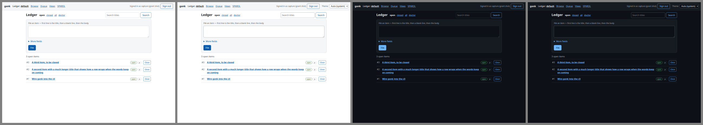 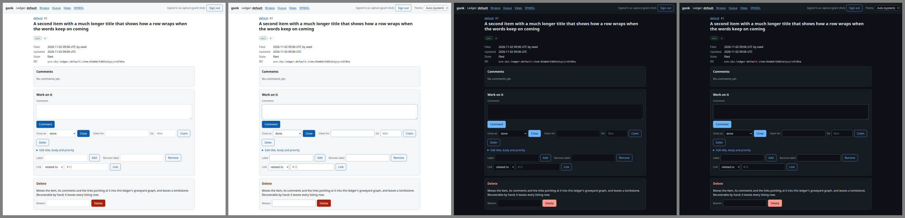 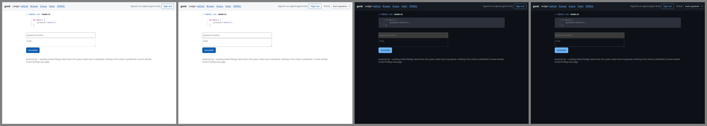 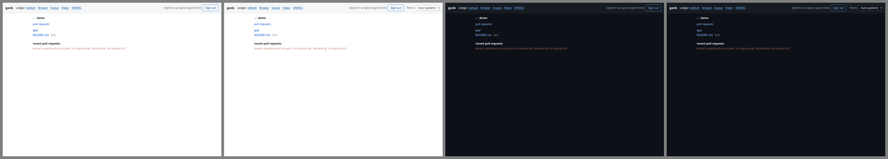
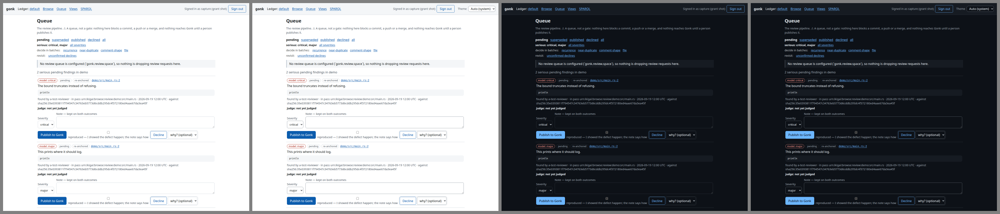 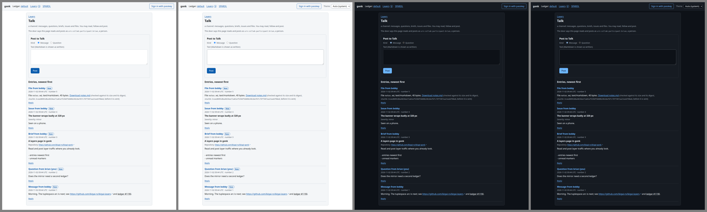 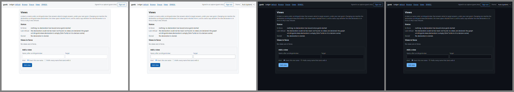
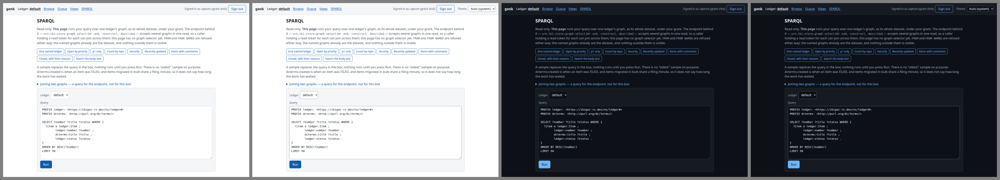 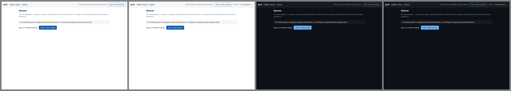 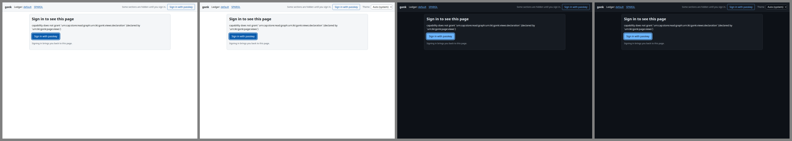
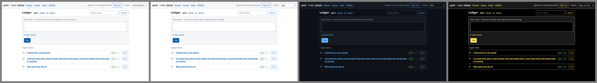
